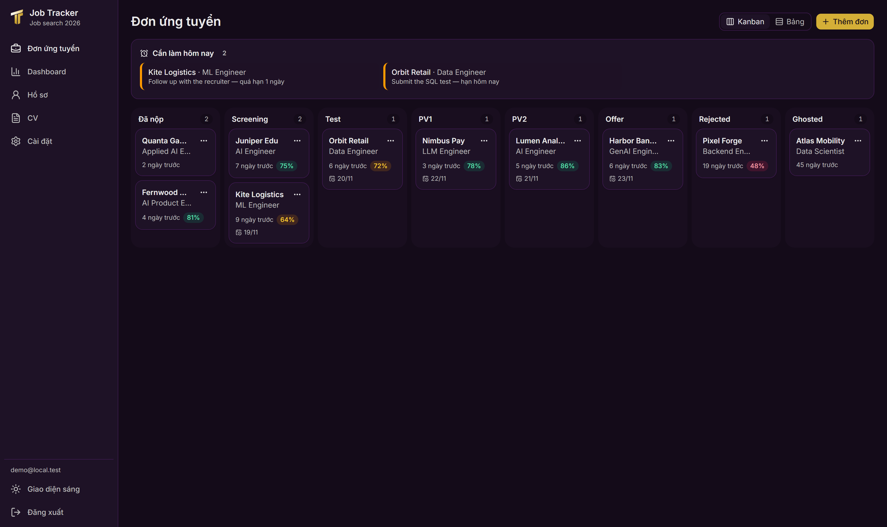
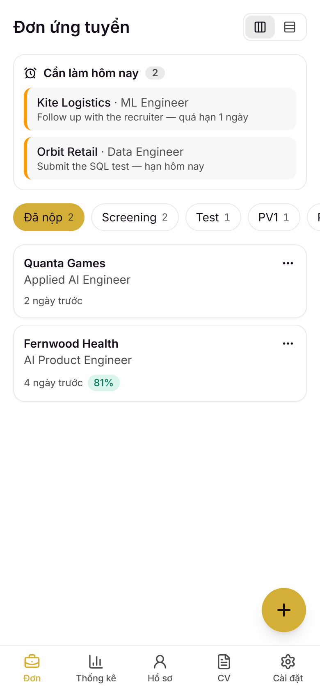
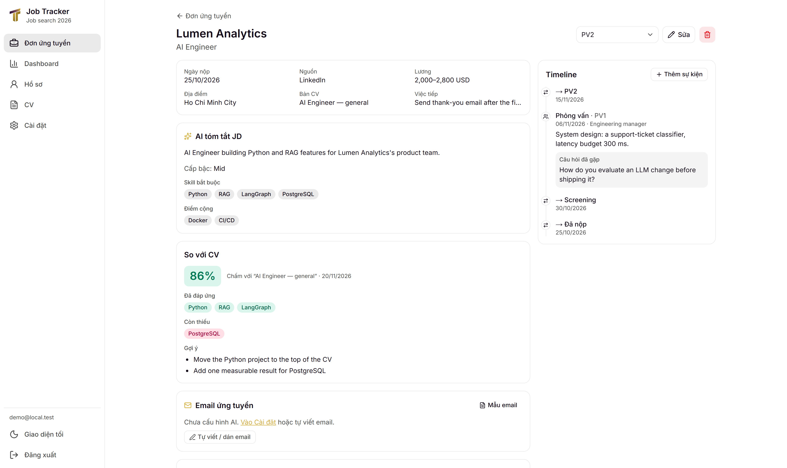
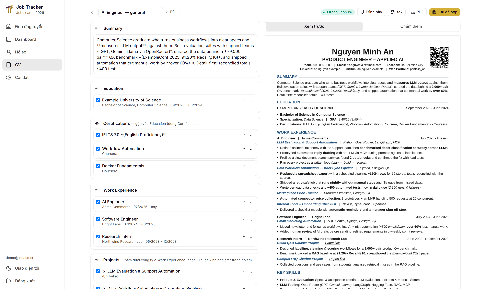
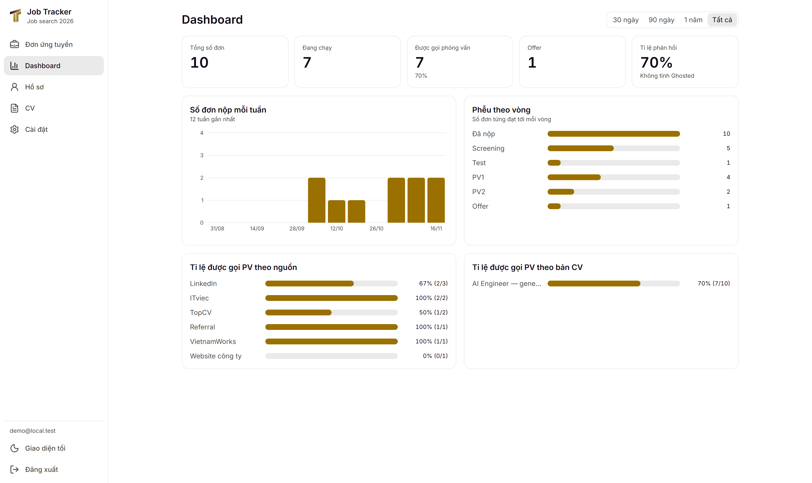
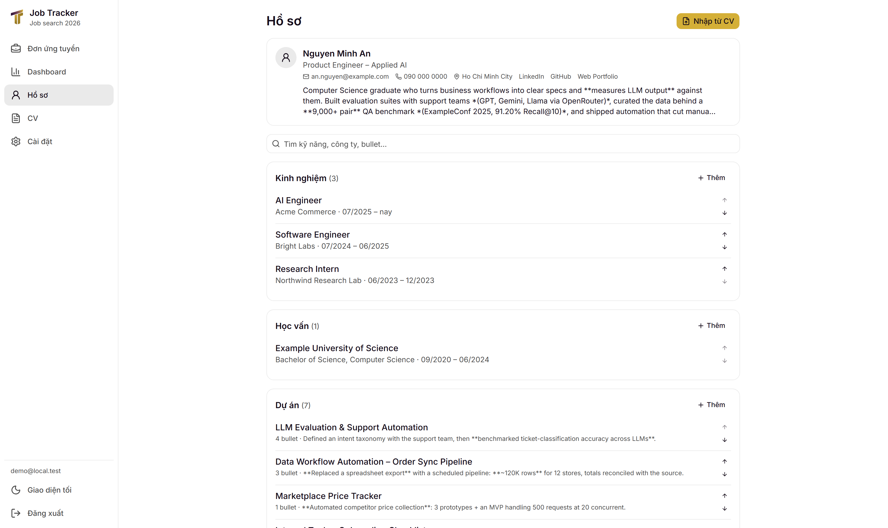

# Job Tracker

A personal job-search workspace: track applications on a Kanban board, keep every interview round on a timeline, build
tailored one-page CVs from a single profile, and let an LLM summarise job descriptions and score how well a CV fits.
It works on phone, tablet and laptop with the same data (Google sign-in).


> The UI is in Vietnamese. All data in the screenshots is fictional (seeded by `scripts/demo/seed.ts`).

## Features

- **Board**: Kanban or table view, drag-and-drop between custom stages, a "today" panel for overdue follow-ups, search, filters and CSV export.
- **Application detail**: JD, salary, source, CV used, next action with a due date, and a timeline of stage changes, interviews and the questions asked.
- **AI on your own key**: summarise a JD (skills, seniority, salary), score a CV against it, draft the application email from your own template. Works with any OpenAI-compatible provider (OpenRouter, Gemini, Ollama) and falls back along a chain of models.
- **Profile → CV builder**: keep experience, projects, education and skills once, then compose CV documents from them with seven templates, a live PDF preview, a one-page fit check, ATS-style scoring against a JD, and PDF / LaTeX (`.tex`) export.
- **CV import**: paste or upload an existing CV (PDF or `.tex`) and merge it into the profile with duplicate detection.
- **Dashboard**: applications per week, stage funnel, response rate by source and by CV version.
- **Workspaces**: invite someone by email to share a workspace; row-level security keeps every workspace isolated.

| Board (dark) | Phone |
|---|---|
|  |  |

| Application | CV builder |
|---|---|
|  |  |

| Dashboard | Profile |
|---|---|
|  |  |

## Stack

Next.js 16 (App Router) · React 19 · Supabase (Postgres, Auth, Storage, RLS) · Tailwind CSS 4 + shadcn/ui · dnd-kit ·
Recharts · @react-pdf/renderer · Zod · Vitest, pgTAP and Playwright.

## Run locally

Requirements: Node 20+, Docker running.

```bash
npm install
npm run db:start            # local Supabase on ports 553xx (API http://127.0.0.1:55321, Studio :55323)
cp .env.example .env.local  # then fill it in from `npx supabase status`
npm run dev                 # http://localhost:3000
```

`.env.local` for local development:

```
NEXT_PUBLIC_SUPABASE_URL=http://127.0.0.1:55321
NEXT_PUBLIC_SUPABASE_ANON_KEY=<ANON_KEY from `npx supabase status`>
SUPABASE_SERVICE_ROLE_KEY=<SERVICE_ROLE_KEY from `npx supabase status`>
AI_KEY_SECRET=<node -e "console.log(require('crypto').randomBytes(32).toString('base64'))">
ALLOWED_EMAILS=dev@local.test,demo@local.test
NEXT_PUBLIC_DEV_LOGIN=1     # shows an email/password login form; never set this in production
```

Demo data: `npx tsx scripts/demo/seed.ts` creates `demo@local.test` / `demo-password` with the fictional data from the
screenshots. With the dev server running, `npx tsx scripts/demo/capture.ts` regenerates `docs/screenshots/` (the GIF
needs ffmpeg).

## Tests

```bash
npm run test        # unit (Vitest): follow-ups, stats, AI parsing, CV resolve/LaTeX/PDF, crypto, CSV, filters
npm run test:db     # RLS (pgTAP): owner / member / outsider, invites, no cross-workspace references
npm run test:e2e    # Playwright on three viewports (phone 390, tablet 834, laptop 1440); needs the dev server + local Supabase
npm run typecheck && npm run lint
```

## Deploy

The app runs on any Next.js host plus a Supabase project. For Vercel:

1. **Supabase**: create a project, then `npx supabase link --project-ref <ref>` and `npx supabase db push`.
2. **Google OAuth**: in Google Cloud Console create an OAuth client ID (Web application) with the redirect URI
   `https://<ref>.supabase.co/auth/v1/callback`, and paste the client ID/secret into Supabase → Authentication → Providers → Google.
   Set the Site URL to your domain and add `https://<domain>/**` to the redirect URLs. Disable the Email provider and,
   after your first sign-in, *Allow new users to sign up*. The app also rejects any email outside `ALLOWED_EMAILS` that has no invite.
3. **Vercel**: `npx vercel link`, add `NEXT_PUBLIC_SUPABASE_URL`, `NEXT_PUBLIC_SUPABASE_ANON_KEY`, `SUPABASE_SERVICE_ROLE_KEY`,
   `AI_KEY_SECRET` (keep it fixed: changing it makes saved AI keys unreadable) and `ALLOWED_EMAILS`, then `npx vercel --prod`.
   `vercel.json` adds a daily cron that keeps a free-tier Supabase project from pausing.

`scripts/deploy.sh` repeats the deploy (new migrations, then Vercel) with tokens read from a gitignored `.env.deploy`
(`SUPABASE_PROJECT_REF`, `SUPABASE_DB_PASSWORD`, `VERCEL_TOKEN`, optional `SUPABASE_POOLER_HOST`).

## AI providers

Configure them on the **Settings** page; any OpenAI-compatible endpoint works:

| Provider | Base URL | Notes |
|---|---|---|
| OpenRouter | `https://openrouter.ai/api/v1` | has `:free` models |
| Gemini | `https://generativelanguage.googleapis.com/v1beta/openai` | key from Google AI Studio |
| Ollama | `http://localhost:11434/v1` | called from the browser; set `OLLAMA_ORIGINS=https://<domain>` |

API keys are encrypted with AES-256-GCM using `AI_KEY_SECRET` and only ever used on the server.

## Project layout

```
app/(app)/          pages: board, /applications/[id], /dashboard, /profile, /cv, /settings
app/api/            AI routes, CV text extraction, cron keepalive
lib/                pure, tested logic: follow-ups, stats, ai, cv (resolve, templates, LaTeX), crypto, csv, profile
lib/data/           server queries + server actions
components/         board, detail, cv-builder, profile, dashboard, settings, ui (shadcn)
supabase/           migrations, pgTAP RLS tests
e2e/                Playwright
scripts/            deploy, demo seed + screenshot capture
proxy.ts            refreshes the session and blocks emails outside ALLOWED_EMAILS
```
